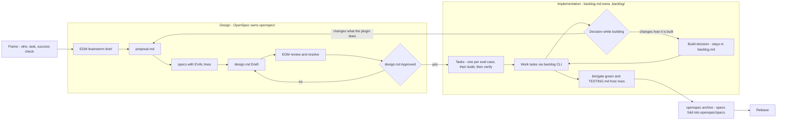

# Workflow

Two tools, two phases, one owner per word.

| Phase | Tool | Owns | Words that belong only here |
| --- | --- | --- | --- |
| Design | OpenSpec (`openspec/`) | proposal, specs, design, archived specs | change, proposal, spec, scenario, requirement, design decision |
| Implementation | backlog.md (`.backlog/`) | tasks, build decisions, build docs | task, build decision |

The handoff is `design.md` with `Status: Approved`. Nothing is built before it;
nothing about the build is written into the change after it.

## Design

1. `/egm:egm-brainstorm <frame>` writes `.dev/egm/concepts_brief.md`.
2. `openspec new change <change-name>`. Write `proposal.md`, then `specs/`.
   `openspec instructions <artifact> --change <change-name>` prints each
   artifact's rules. Every scenario ends with `- **EVAL** evals/<skill>/<case>`.
3. `/egm:egm-draft` from the proposal and specs; save as the change's `design.md`.
4. `/egm:egm-review openspec/changes/<change-name>/design.md`, then
   `/egm:egm-resolve`. Record rejected findings under Review.
5. Only the owner sets `Status: Approved`. `openspec validate --all --strict`, commit.

## Implementation

1. Create backlog.md tasks from the approved design, in this order: one per eval
   case the specs name, then skills, references, resources and agents, then
   `python3 scripts/pack_plugin.py --sync` and `bin/gate`, then the verify tier
   from `TESTING.md`. Each task names the scenario or file it satisfies.
2. Work the tasks through the `backlog` CLI only; never edit `.backlog/` by hand.
3. A decision made while building is a backlog.md decision. A decision that
   changes what the plugin does goes back to design as a new change.
4. Done: `bin/gate` green, `TESTING.md` host rows recorded, `openspec archive
   <change-name>`, which folds the specs into `openspec/specs/`.

Bug fixes skip design: fix, gate, verify the affected host, release a patch.
